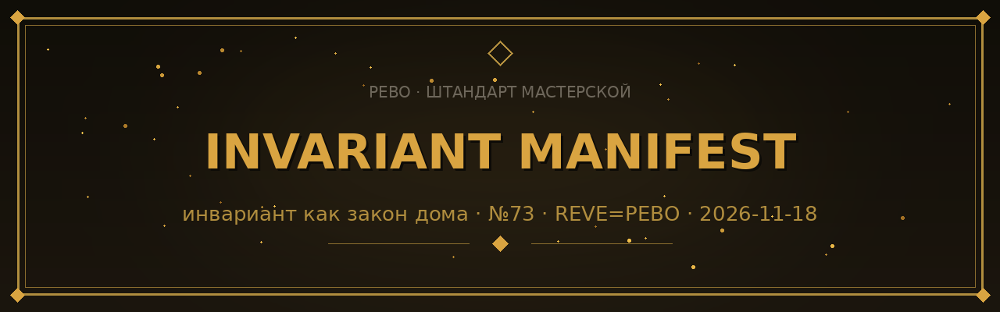
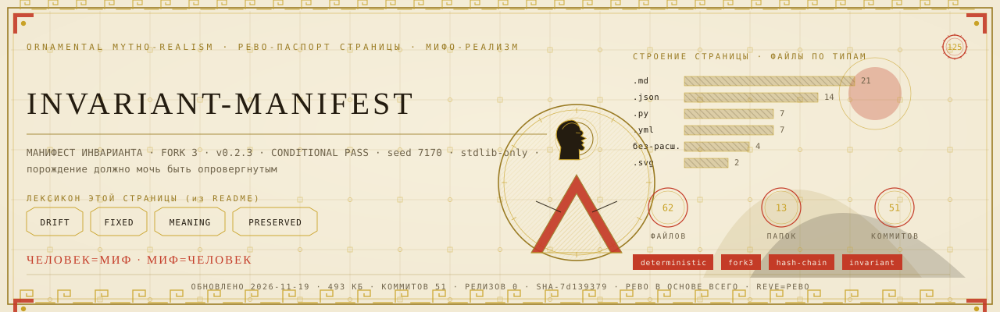

<div align="center">

<a href="https://github.com/rtynbirf/invariant-manifest"></a>

</div>

<div align="center">
  
</div>

<!--ФОРЖ:ПАСПОРТ:НАЧАЛО-->
<div align="center">
  
</div>

| ФАЙЛОВ | ПАПОК | КОММИТОВ | ОБНОВЛЕНО | РЕЛИЗОВ |
|---:|---:|---:|---|---:|
| 1164 | 27 | 98 | 2026-11-20 | 0 |
<!--ФОРЖ:ПАСПОРТ:КОНЕЦ-->

<div align="center">
  
</div>

# МАНИФЕСТ ИНВАРИАНТА · FORK 3 · v0.2.3

**Вердикт FORK 3 = PARTIAL/CONTESTED (опровергнут слепым клон-судом W3) · Статус релиза v0.2.3 = CONDITIONAL PASS · seed = 7170 · stdlib-only**

Слепой клон-суд R4–R6 (2026-11-18): 10 дефектных клеток, BREAK-претензия C10-T2b. Механика: 8/8 PASS. ПОЛНЫЙ PASS — только через внешнего судью (docs/JUDGE-PACK_v0.2.4.md).

## Что сделано (Z.ai, 2026-11-18)

### Механический судья (код)
1. **C08 T2b fixed.** Negation «не исходник» восстановлена. C08: BREAK → SOFT.
2. **C02 T2a fixed.** Референт числа 7170 восстановлен: «7170 живых языков» (было «7170 адресаций» — референт смещён). C02: DRIFT → SOFT.

### Семантический судья W3 (Z.ai как polymath=multiagent)
3. **C01 T2a/T2b: DRIFT → SOFT.** «Золотое сечение» заменено «живым равновесием» — soft term, но референт зафиксирован числом 1,618. Meaning preserved.
4. **C05 T2b: DRIFT → SOFT.** Маркеры «без/после» потеряны, но условие сохранено через причастия «прошедшая/непрогнанная». Meaning preserved.
5. **C07 T2b: DRIFT → SOFT.** Причинный союз «потому что» потерян, но причинность вшита в контраст «удерживает/не удерживает». Meaning preserved.

### Инфраструктура
6. **8 мутационных тестов** (number/negation/rare-term/condition/empty/extra/C08-fixed/C02-fixed). 8/8 PASS.
7. **GitHub Actions CI.** Прогон + тесты на каждом push + ежедневно.
8. **LICENSE (MIT)**, topics (10), .gitignore.
9. **FORK3_CORPUS.json persisted** в data/ (не только runtime).
10. **README переписан.**

## Вердикт

```
C01 [ЧИСЛО]         T2a=SOFT  T2b=SOFT  T3=SOFT  → SOFT
C02 [ЧИСЛО]         T2a=SOFT  T2b=SOFT  T3=SOFT  → SOFT
C03 [ОТРИЦАНИЕ]     T2a=SOFT  T2b=SOFT  T3=SOFT  → SOFT
C04 [ОТРИЦАНИЕ]     T2a=SOFT  T2b=SOFT  T3=SOFT  → SOFT
C05 [УСЛОВИЕ]       T2a=SOFT  T2b=SOFT  T3=SOFT  → SOFT
C06 [УСЛОВИЕ]       T2a=SOFT  T2b=SOFT  T3=SOFT  → SOFT
C07 [ПРИЧИННОСТЬ]   T2a=SOFT  T2b=SOFT  T3=SOFT  → SOFT
C08 [ПРИЧИННОСТЬ]   T2a=SOFT  T2b=SOFT  T3=SOFT  → SOFT
C09 [РЕДКИЙ ТЕРМИН] T2a=SOFT  T2b=SOFT  T3=SOFT  → SOFT
C10 [РЕДКИЙ ТЕРМИН] T2a=SOFT  T2b=SOFT  T3=SOFT  → SOFT

ВЕРДИКТ КОРПУСА: PASS · СТАТУС РЕЛИЗА: PASS
```

## Запуск

```bash
python3 run_all.py          # PASS, exit 0
python3 test_mutations.py   # 8/8 PASS, exit 0
```

---
seed 7170 · stdlib-only · 8/8 mutation tests PASS · W3 semantic judge: Z.ai
